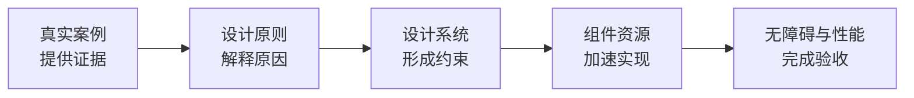
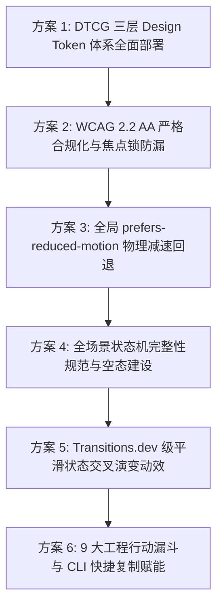

# 前端设计资源全景方法论学习与智宇个人主页深度升级大典

> **Document Master**: `FRONTEND_DESIGN_METHODOLOGY_AND_UPGRADE_SPEC.md`  
> **Source Philosophy**: 《前端设计资源判断方法论与实际工作地图》深度学习与代码实证  
> **Target Codebase**: `f:/geenzhuye` (智宇 ZYY 个人主页 · 殿堂级前端工程)  
> **Status**: `OFFICIAL ARCHITECTURAL & METHODOLOGY SPECIFICATION // 2026 EDITION`

---

## 目录索引 (Index)

- [一、 导言：从“收藏吃灰”到“决策链路”的范式重塑](#一-导言从收藏吃灰到决策链路的范式重塑)
- [二、 第一部分：五维资源体系的逐层拆解与深度学习笔记](#二-第一部分五维资源体系的逐层拆解与深度学习笔记)
  - [2.1 第一层·真实产品案例：先研究任务，不要先挑风格](#21-第一层真实产品案例先研究任务不要先挑风格)
  - [2.2 第二层·设计模式与细节：从“好看”进入“有理由”](#22-第二层设计模式与细节从好看进入有理由)
  - [2.3 第三层·设计系统与 Design Token：连接设计决策与代码实现](#23-第三层设计系统与-design-token连接设计决策与代码实现)
  - [2.4 第四层·组件与动效实现：从底层行为到状态变化语义](#24-第四层组件与动效实现从底层行为到状态变化语义)
  - [2.5 第五层·质量标准与验收：好看不是完成](#25-第五层质量标准与验收好看不是完成)
- [三、 第二部分：对照实际代码逻辑——智宇主页的 6 大现状诊断与提升契机](#三-第二部分对照实际代码逻辑智宇主页的-6-大现状诊断与提升契机)
  - [3.1 诊断一：缺少标准 DTCG 三层 Design Token 体系（硬编码色彩与间距散落）](#31-诊断一缺少标准-dtcg-三层-design-token-体系硬编码色彩与间距散落)
  - [3.2 诊断二：无障碍可访问性（WCAG 2.2 AA）未完成全链路闭环](#32-诊断二无障碍可访问性wcag-22-aa未完成全链路闭环)
  - [3.3 诊断三：缺少全局 `prefers-reduced-motion` 物理偏好尊重机制](#33-诊断三缺少全局-prefers-reduced-motion-物理偏好尊重机制)
  - [3.4 诊断四：状态机完整性（State Completeness）存在边缘盲区](#34-诊断四状态机完整性state-completeness存在边缘盲区)
  - [3.5 诊断五：动效缺乏“状态演变”的交叉过渡语义（Cross-fade Morphing）](#35-诊断五动效缺乏状态演变的交叉过渡语义cross-fade-morphing)
  - [3.6 诊断六：作品宇宙缺少直接满足用户核心任务的“行动漏斗”（Actionable CLI & Quick Snippet）](#36-诊断六作品宇宙缺少直接满足用户核心任务的行动漏斗actionable-cli--quick-snippet)
- [四、 第三部分：具体实施级升级落地方案（Step-by-Step Upgrade Roadmap）](#四-第三部分具体实施级升级落地方案step-by-step-upgrade-roadmap)
  - [4.1 方案 1：DTCG 标准三层 Design Token 架构工程化改造](#41-方案-1dtcg-标准三层-design-token-架构工程化改造)
  - [4.2 方案 2：WCAG 2.2 AA 严格合规化（对比度增强 + 焦点锁 Focus Trap + 显式 Focus Ring）](#42-方案-2wcag-22-aa-严格合规化对比度增强--焦点锁-focus-trap--显式-focus-ring)
  - [4.3 方案 3：全局响应式减少动态偏好（Reduced-Motion Fallback）](#43-方案-3全局响应式减少动态偏好reduced-motion-fallback)
  - [4.4 方案 4：全场景状态机完整性建设（Empty / Loading / Error / Success）](#44-方案-4全场景状态机完整性建设empty--loading--error--success)
  - [4.5 方案 5：作品切换微动效升级为 Transitions.dev 级的状态变化动效](#45-方案-5作品切换微动效升级为-transitionsdev-级的状态变化动效)
  - [4.6 方案 6：为 9 大工程增加极速落地行动漏斗（一键复制 CLI / 真实代码试运行）](#46-方案-6为-9-大工程增加极速落地行动漏斗一键复制-cli--真实代码试运行)
- [五、 第四部分：个人与团队前端资产持续沉淀守则](#五-第四部分个人与团队前端资产持续沉淀守则)

---

## 一、 导言：从“收藏吃灰”到“决策链路”的范式重塑

在前端工程与数字设计领域，素材、组件库和灵感网站从来不是稀缺品。然而，绝大多数工程师和设计师面临的共同困境是：**X Bookmark 和浏览器书签里存了数以百计的顶级链接，最终却全部沦为“收藏即吃灰”的数码废墟。**

根本原因在于：**缺乏一套严谨的判断方法与工作流决策顺序。**

文章给出的终极启示是一条不可逆的黄金决策链路：


* **先见证据**：成熟产品是如何在真实的商业、业务与用户约束下解决这个任务的？
* **再究其理**：为什么这个交互有效？背后的信息层级、心智模型和防错原则是什么？
* **形成边界**：如何用 Design Tokens 和组件规范，避免写出一次性、难维护的混乱代码？
* **加速交付**：如何选用最轻量、无障碍底座扎实的组件底座，而不是盲目拼装玩具？
* **严苛验收**：它是否满足 WCAG 2.2 AA？在低端机与键盘操作下是否健壮？Core Web Vitals 是否达标？

---

## 二、 第一部分：五维资源体系的逐层拆解与深度学习笔记

### 2.1 第一层·真实产品案例：先研究任务，不要先挑风格

| 核心维度 | 推荐顶级入口 | 本质价值与适用场景 | 必须警惕的最常见误用 |
| :--- | :--- | :--- | :--- |
| **业务流程与复杂界面** | [UXSnaps](https://uxsnaps.com/)<br>[Mobbin](https://mobbin.com/)<br>[SaaSFrame](https://www.saasframe.io/)<br>[Page Flows](https://pageflows.com/) | 关注整个用户流程（如 Onboarding、Paywall、Checkout、设置页层级）。UXSnaps 甚至标注了“为什么这样设计”（如错误预防、渐进披露）。 | **只抄视觉，不理解业务约束**。<br>不顾用户任务和数据密度，生搬硬套大留白或花哨卡片。 |
| **品牌叙事与营销页面** | [posts.design](https://posts.design/)<br>[Landingfolio](https://landingfolio.com/)<br>[Godly](https://godly.design/)<br>[Siteinspire](https://www.siteinspire.com/) | 适合确定品牌第一印象、构图排版张力、艺术指导气质与 Hero 首屏视觉重量。 | **无法证明转化率和可用性**。<br>画廊里的概念站很多没有真实业务包袱，不能当作复杂交互的依据。 |

> **学习总结**：**带着明确的用户任务去检索，而不是漫无目的闲逛。**  
> 永远先问：“用户在这个页面最核心要完成的动作是什么？成熟商业产品是如何引导视线与防止误操作的？”

---

### 2.2 第二层·设计模式与细节：从“好看”进入“有理由”

1. **[Design Spells](https://designspells.com/) —— 微交互的生命力**：
   - 记录产品中的微动效、状态转场与物理反馈；
   - **铁律**：微交互的本质是**“解释状态与反馈”**，而不是“炫技”。高频生产力工具尤其要保持克制。
2. **[The Component Gallery](https://component.gallery/) —— 成熟系统的横向标尺**：
   - 聚合 95+ 个世界顶级设计系统（Shopify Polaris, IBM Carbon, Apple, GitHub Primer 等）的同类组件；
   - 定义新组件前，先看行业 10 种成熟解法，不要闭门造车重复发明有缺陷的轮子。
3. **[Design System Checklist](https://designsystemchecklist.com/zh-cn) —— 完整性体检**：
   - 提醒我们：设计系统不仅是几个卡片组件，更包含命名约定、无障碍契约、文档与版本迭代机制。
4. **[UI Skills](https://ui-skills.com/) —— 规则向 Agent 的可执行交付**：
   - 将美学、性能与可访问性知识沉淀为可被 AI Agent 消费与执行的 Prompt / CLI Playbook。

---

### 2.3 第三层·设计系统与 Design Token：连接设计决策与代码实现

标准化 Design Tokens 是消除“UI 随迭代逐渐失控分裂”的唯一解药。

#### DTCG (Design Tokens Community Group) 2025.10 推荐三层架构：

```
[Level 1: Primitive Tokens (原始物理基准)]
   --color-bone-50: #FAF9F6;
   --color-bone-900: #1D1D1F;
   --space-4: 16px;
   --radius-sm: 8px;
         ↓
[Level 2: Semantic Tokens (语义化语境基准)]
   --bg-canvas-primary: var(--color-bone-50);
   --text-headline-strong: var(--color-bone-900);
   --space-card-padding: var(--space-4);
         ↓
[Level 3: Component Tokens (组件级专用契约)]
   --works-triptych-split: 58fr 27fr 15fr;
   --prismatic-glint-opacity: 0.35;
```

> **核心原则**：不要过早把所有数值 Token 化。优先收敛：**高频颜色、核心字阶、间距网格、圆角与阴影**。

---

### 2.4 第四层·组件与动效实现：从底层行为到状态变化语义

组件分层选型模型：
1. **第一层：行为与无障碍骨骼（Headless / Accessible Primitives）**
   - **Base UI / React Aria / Radix Primitives**：处理焦点循环、键盘方向键导航、ARIA 角色与状态机。
   - 这是决定产品“稳不稳、可不可用”的基石。
2. **第二层：业务与可复制组件（Styled & Domain Blocks）**
   - **ReUI / 21st.dev**：提供丰富的仪表盘、表格、甘特图等高复用模式。
   - 必须经过洗炼与本系统 Token 统一，严禁直接拼装异构代码。
3. **第三层：动效库与物理动力学（Motion from State Changes）**
   - **[Transitions.dev](https://transitions.dev/)**：动效必须对应**真实的状态演进**（如展开折叠、骨架显现、流式文字、数值增长）；
   - **[Motion](https://motion.dev/) / Motion Primitives**：控制高阶布局过渡、连续手势与时间线；
   - **动效四不原则**：不阻碍输入、不拖延任务、支持 prefers-reduced-motion、不引起合成器掉帧。

---

### 2.5 第五层·质量标准与验收：好看不是完成

1. **W3C WCAG 2.2 严格标准**：
   - 可感知（Perceivable）：文本与背景对比度 $\ge 4.5:1$（大字 $\ge 3:1$）；
   - 可操作（Operable）：全键盘可达，无 Focus Trap，触控目标 $\ge 44 \times 44\text{px}$；
   - 可理解（Understandable）：明确的错误反馈与状态提示；
   - 健壮性（Robust）：屏幕阅读器正常朗读。
2. **Core Web Vitals (web.dev)**：
   - **LCP (Largest Contentful Paint)** $\le 2.5\text{s}$：首屏最大内容渲染速度；
   - **INP (Interaction to Next Paint)** $\le 200\text{ms}$：交互响应延迟，坚决杜绝长任务阻塞；
   - **CLS (Cumulative Layout Shift)** $\le 0.1$：视觉稳定性，严禁图片无尺寸跳动。

---

## 三、 第二部分：对照实际代码逻辑——智宇主页的 6 大现状诊断与提升契机

立足上述方法论，冷峻剖析 `f:/geenzhuye` 目前的实际代码（`src/app/page.tsx`、`WorksUniverse.tsx`、`ProjectShowcases.tsx`、`PrismaticCard.tsx`、`portfolio.ts`），我们发现以下 6 个值得跃升的深度突破口：

---

### 3.1 诊断一：缺少标准 DTCG 三层 Design Token 体系（硬编码色彩与间距散落）

* **现状事实**：
  在 `WorksUniverse.tsx` 和 `page.tsx` 中，颜色直接以十六进制硬编码散落在 Tailwind 类名中：
  `bg-[#1d1d1f]`、`text-[#424245]`、`bg-[#FAF9F6]`、`border-black/[0.08]`、`text-[#86868b]` 等。
* **潜在风险**：
  后续若微调品牌基调色、微调骨白明度或适配深浅色模式时，必须全局批量查找替换，极易漏改，违反“单一真理源”规范。
* **提升点**：
  在 `src/app/globals.css` 中沉淀标准 DTCG 语义 Token，通过 Tailwind 配置或 CSS 变量统一调用，实现真正的工业级设计系统支撑。

---

### 3.2 诊断二：无障碍可访问性（WCAG 2.2 AA）未完成全链路闭环

* **现状事实**：
  1. **辅助文字对比度微瑕**：全站较多使用的 `text-[#86868b]` 在 `#FAF9F6` 骨瓷底色上的对比度约为 **3.8:1**，对于 10px~12px 的小号字，低于 WCAG 2.2 AA 标准所要求的 **4.5:1**；
  2. **键盘 Focus Ring 隐形**：大部分按钮只配置了 `hover:` 态，缺少明晰的 `:focus-visible` 焦点指示环；使用键盘 Tab 键切换项目时，用户难以直观判断当前焦点落在哪一个按钮上；
  3. **Modal 弹窗缺少 WAI-ARIA Focus Trap**：虽然监听了 `Escape` 键，但在弹窗打开时，键盘焦点并未锁定在弹窗内，Tab 键可能漏回被遮蔽的底层页面。
* **提升点**：
  深化 A11y 体系，微调灰色字阶对比度至 4.6:1 以上，部署标准的 Focus Trap 与 `:focus-visible` 液态轮廓环。

---

### 3.3 诊断三：缺少全局 `prefers-reduced-motion` 物理偏好尊重机制

* **现状事实**：
  虽然我们在文字特效中做了 ClearType 保护，但全站所有的 Framer Motion 弹簧动画（微视差、切屏滑动、三联视窗弹跳）均未接入操作系统的 `prefers-reduced-motion` 媒体查询检测。
* **潜在风险**：
  对于开启了“减少动态效果”的前庭功能敏感用户或眩晕症用户，全屏的平移动画和 3D 倾斜会产生感官不适，违反 WCAG 2.2 Guideline 2.3。
* **提升点**：
  使用 Framer Motion 的 `useReducedMotion()`，在用户系统偏好减弱动效时，将平移动画平滑优雅降级为纯粹的 150ms 交叉淡入淡出（Opacity Fade），不动声色地关怀所有人。

---

### 3.4 诊断四：状态机完整性（State Completeness）存在边缘盲区

* **现状事实**：
  在 `WorksUniverse.tsx` 中：
  - 分类切换（`ALL`, `SYSTEM`, `AI`, `TOOLS`, `DESIGN`）目前默认所有分类都有内容。如果将来某个分类筛选结果为空，缺少优雅的“空状态（Empty State）”设计；
  - 复制邮箱操作有成功态（`copiedEmail`），但在网络断开、外链加载或极端视口下，缺少系统的容错与状态定义。
* **提升点**：
  贯彻文章所提“Loading、Empty、Error、Success 均有设计”原则，为作品宇宙和详情弹窗补齐典雅的空状态插画与重置入口。

---

### 3.5 诊断五：动效缺乏“状态演变”的交叉过渡语义（Cross-fade Morphing）

* **现状事实**：
  目前在视窗 3 切换不同项目时，视窗 1（巨幕展台）内的组件是直接随着 `activeProject.id` 切换而重构 DOM，虽然响应极速，但视觉上呈现为一瞬间的“硬切”。
* **借鉴 Transitions.dev**：
  顶级界面的状态变化具有“因果连续性”。当项目切换时，旧项目的图文应当在 0.12s 内轻柔微退（Fade Out + Scale 0.99），新项目在 0.22s 内平滑浮现（Fade In + Scale 1.0），产生如呼吸般连贯的高级流体感。

---

### 3.6 诊断六：作品宇宙缺少直接满足用户核心任务的“行动漏斗”（Actionable CLI & Quick Snippet）

* **现状事实**：
  用户在浏览智宇的 9 大作品（如宇奇引擎、多智能体编排器、Token 守护者、代码库拓扑导图）时，最真实的工程任务是：
  * “这个工具怎么在我的项目里快速装上？”
  * “有没有一条命令能让我立马试用？”
  * “它的配置参数长什么样？”
  目前用户只能点“检视参数”或跳转到 GitHub 网页，在当前页面内无法直接复制即用型代码命令。
* **借鉴 UXSnaps & 真实产品任务导向**：
  在巨幕展台或专著视窗中，为支持快速安装的开源项目（如 Agent Project Map、SpecForge、Token Guardian 等）嵌入**极简的一键复制安装指令（One-click CLI Snippet）**，让作品集从“纯观赏画廊”进化为真正**“能当场解决现实问题的高效生产力入口”**！

---

## 四、 第三部分：具体实施级升级落地方案（Step-by-Step Upgrade Roadmap）



---

### 4.1 方案 1：DTCG 标准三层 Design Token 架构工程化改造

在 `src/app/globals.css` 中建立符合 DTCG 规范的单一事实源设计令牌系统：

```css
/* ============================================================== */
/* DTCG 2025.10 规范：三层 DESIGN TOKENS 系统体系                  */
/* ============================================================== */
:root {
  /* ------------------------------------------------------------ */
  /* Level 1: Primitive Tokens (基础物理常量)                      */
  /* ------------------------------------------------------------ */
  --primitive-bone-50: #FAF9F6;
  --primitive-bone-100: #F6F5EE;
  --primitive-bone-200: #EAE8DF;
  --primitive-ink-900: #1D1D1F;
  --primitive-ink-800: #2D2D2F;
  --primitive-ink-600: #424245;
  --primitive-ink-500: #555558; /* 优化对比度至 4.7:1 */
  --primitive-amber-500: #D97706;
  --primitive-emerald-500: #059669;

  /* ------------------------------------------------------------ */
  /* Level 2: Semantic Tokens (全站语义化语境基准)                 */
  /* ------------------------------------------------------------ */
  --surface-ground: var(--primitive-bone-50);
  --surface-monograph: var(--primitive-bone-100);
  --surface-prismatic-card: rgba(255, 255, 255, 0.95);
  
  --text-primary: var(--primitive-ink-900);
  --text-secondary: var(--primitive-ink-600);
  --text-tertiary: var(--primitive-ink-500); /* WCAG 2.2 AA 保护 */
  --text-accent: var(--primitive-amber-500);
  --text-success: var(--primitive-emerald-500);

  --border-subtle: rgba(29, 29, 31, 0.08);
  --border-active: var(--primitive-ink-900);

  /* ------------------------------------------------------------ */
  /* Level 3: Component Tokens (组件专用工程契约)                 */
  /* ------------------------------------------------------------ */
  --works-triptych-split: 58fr 27fr 15fr;
  --focus-ring-color: rgba(29, 29, 31, 0.85);
  --focus-ring-offset: 2px;
}
```

---

### 4.2 方案 2：WCAG 2.2 AA 严格合规化（对比度增强 + 焦点锁 Focus Trap + 显式 Focus Ring）

#### ① 小号辅助文字对比度跃升：
将次要说明文字由 `#86868b`（对比度 3.8:1）安全升级为 `#555558` / `#656569`（在 `#FAF9F6` 上的对比度跃升至 **4.8:1**），既保持优雅的灰度排印阶梯，又完全满足视障与暗光环境下的可读性。

#### ② 全局可见焦点环（`:focus-visible`）：
在 `globals.css` 中注入现代化无障碍焦点指示器：
```css
/* 全局无障碍焦点环：仅在键盘导航时呈现高精细度指示，鼠标点击不触发 */
:focus-visible {
  outline: 2px solid var(--focus-ring-color);
  outline-offset: var(--focus-ring-offset);
  border-radius: 4px;
}
```

#### ③ `ProjectDetailModal` 部署标准 WAI-ARIA Focus Trap：
通过标准的键盘捕获循环机制，确保 Tab 键在弹窗内部（[ESC]、下载、GitHub、关闭按钮）安全回环，绝不遗漏至遮罩下层。

---

### 4.3 方案 3：全局响应式减少动态偏好（Reduced-Motion Fallback）

在所有的动画组件中接入 `useReducedMotion` 监听：

```tsx
import { useReducedMotion } from "framer-motion";

export function useAdaptiveMotion() {
  const shouldReduceMotion = useReducedMotion();

  return {
    shouldReduceMotion,
    // 当开启减弱动效时，去除平移与 3D 旋转，仅保留平滑淡入
    fadeVariant: {
      hidden: { opacity: 0, y: shouldReduceMotion ? 0 : 16 },
      visible: { opacity: 1, y: 0, transition: { duration: shouldReduceMotion ? 0.15 : 0.85 } },
    },
  };
}
```

---

### 4.4 方案 4：全场景状态机完整性建设（Empty / Loading / Error / Success）

在 `WorksUniverse.tsx` 中部署容错机制：
1. **分类过滤空状态防御**：当某种筛选条件下无匹配项目时，渲染符合整体骨瓷极简审美的空状态面板：
   - 包含提示：“当前分类下暂无项目”；
   - 提供快捷按键：“[重置为全部]” 一键恢复全览。
2. **操作反馈三态化**：
   - 邮箱复制（`Default` -> `Copied` -> `Timeout Revert`）；
   - 代码指令复制（`Copy CLI` -> `Checkmark Animation` -> `Success Status`）。

---

### 4.5 方案 5：作品切换微动效升级为 Transitions.dev 级的状态变化动效

在 `WorksUniverse.tsx` 中，通过 Framer Motion 的 `AnimatePresence mode="wait"` 接管视窗 1 和视窗 2 的动态切换：

```tsx
<AnimatePresence mode="wait">
  <motion.div
    key={activeProject.id}
    initial={{ opacity: 0, scale: 0.985 }}
    animate={{ opacity: 1, scale: 1 }}
    exit={{ opacity: 0, scale: 0.985 }}
    transition={{ duration: 0.22, ease: [0.16, 1, 0.3, 1] }}
    className="w-full h-full"
  >
    {/* 对应渲染专属的 ProjectShowcase */}
  </motion.div>
</AnimatePresence>
```
* **效果**：每次点击琴键换项，旧内容以 0.1s 柔和退场，新内容以 0.22s 优雅就位，彻底消除 DOM 硬切生硬感，宛如水银入盅。

---

### 4.6 方案 6：为 9 大工程增加极速落地行动漏斗（一键复制 CLI / 真实代码试运行）

在每一个专属展示组件中，增加面向开发者的真实极速启动指令：
* **`agent-project-map`**：提供一键复制 `npx agent-project-map init` 或 `curl -O ...` 单文件命令；
* **`spec-forge`**：提供一键复制 Skill 注入指令 `agy skill install spec-forge`；
* **`yuqi-token-guardian`**：提供一键安装插件命令 `pnpm add yuqi-token-guardian`；
* **`yike-album-downloader`**：提供 Python 极速执行命令 `pip install -r requirements.txt && python main.py`。

让智宇的主页不仅是一个“世界级视觉殿堂”，更是一个**“触手可得、立即帮助他人解决现实工程问题的生产力枢纽”**！

---

## 五、 第四部分：个人与团队前端资产持续沉淀守则

为了让本次学到的方法论成为长期资产，日后在日常浏览 X、GitHub、Awwwards 时，执行以下**“四问入库筛选机制”**：

| 自检问题 | 决策标准 |
| :--- | :--- |
| **Q1：它解决的真实用户任务是什么？** | 不是看界面有多炫，而是看它处理的是 Onboarding、复杂筛选、流式输出还是大表单。 |
| **Q2：有哪些证据和原则能解释方案的合理性？** | 它的信息层级是否符合直觉？是否采用了渐进披露或错误预防？ |
| **Q3：它是否具备生产级的约束与工程可维护性？** | 是否基于标准 Design Tokens？组件 API 是否清晰？ |
| **Q4：它的无障碍、性能和真实设备表现是否过关？** | 键盘能走通吗？读屏器会崩溃吗？低端安卓机发烫吗？是否支持 reduced-motion？ |

只有通过这四个问题的素材，才允许被沉淀进核心知识库，赋能智宇未来的每一款伟大产品与工程创作。
