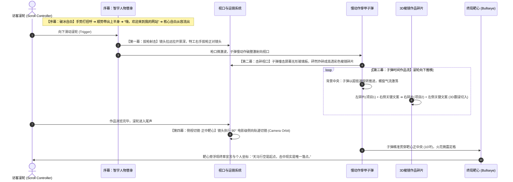

# 智宇 (ZYY) 个人主页 · 先锋视觉灵感与参考案例研判大典
> **Document**: `INSPIRATION_LOG.md`  
> **Purpose**: 持续沉淀用户与架构师关于外部顶级网站案例的深度探讨、真假需求去伪存真、可融入设计内核与避坑红线记录。  
> **Master Reference**: [`VISUAL_DESIGN_BIBLE.md`](./VISUAL_DESIGN_BIBLE.md)  
> **Status**: `LIVING EXPLORATION ARCHIVE // 2026 EDITION`

---

## 目录索引 (Index)

- [一、 讨论原则与甄别准绳](#一-讨论原则与甄别准绳)
- [二、 案例研判归档 (Case Archive)](#二-案例研判归档-case-archive)
  - [【Case 01】Santioni Spirits (`santionispirits.com`) —— 漫画分镜与沉浸式叙事体验](#case-01santioni-spirits-santionispiritscom--漫画分镜与沉浸式叙事体验)
  - [【Case 02】Revelatio Studio (`revelatio.studio`) —— 顶级产品代码咨询站与机械字符美学](#case-02revelatio-studio-revelatiostudio--顶级产品代码咨询站与机械字符美学)
  - [【Case 03】Orgnzm Studio (`orgnzm.studio`) —— 3D-First 空间有机物与立体交互装配](#case-03orgnzm-studio-orgnzmstudio--3d-first-空间有机物与立体交互装配)
  - [【Case 04】Scheme Engine (`schemeengine.com`) —— 电影级流体推轨与 WebGL 画面沉浸式位移](#case-04scheme-engine-schemeenginecom--电影级流体推轨与-webgl-画面沉浸式位移)
  - [【Case 05】Zero University (`why.zero.university`) —— 悬浮玻璃棱镜折射与高阶微交互游戏化](#case-05zero-university-whyzerouniversity--悬浮玻璃棱镜折射与高阶微交互游戏化)
- [三、 灵感资产库与工程落地对照表](#三-灵感资产库与工程落地对照表)

---

## 一、 讨论原则与甄别准绳

为防止“收藏吃灰”或“盲目拼凑玩具”，所有外部参考页面的引入探讨必须坚守以下铁律：
1. **说实话，不盲目迎合**：不为炫技而做动效，以客观事实与认知工效学（UX）为准绳，核验方案是否真正契合创作者的真实定位。
2. **取其神，弃其形**：剥离表面特定的行业装饰（如酒类虚构漫画、游戏UI等），提炼底层的排印张力、数学网格、时间缓动与物理材质。
3. **服务于三大核心底线**：
   - 彰显智宇（ZYY）“负责天马行空大胆构想、亲手用 AI 落地产品的卓越工程师”的真实力量；
   - 保持幸运数字 7 的纯质数哲学与严谨秩序；
   - 绝不破坏四句神圣文案的逐字神圣性。

---

## 二、 案例研判归档 (Case Archive)

### 【Case 01】Santioni Spirits (`santionispirits.com`) —— 漫画分镜与沉浸式叙事体验

#### 1. 案例基本信息与背景
* **网址**：[https://santionispirits.com/](https://santionispirits.com/)
* **行业属性**：高级酒类（Spirits / 龙舌兰 / 金酒）品牌营销体验站（Awwwards Nominee 2026 / CSS Design Awards）
* **核心表现**：黑白手绘美式/欧漫墨线画风（Graphic Novel / Comic Strip）、苦行僧漫步虚无之境的虚构叙事、多重分镜插图（In-panel insets）、滚轮推轨锁定式 Scrollytelling、 Three.js / WebGL + GSAP。

#### 2. 客观研判结论：为什么不能直接照搬其“形式”？
* **冲突点 A：叙事载体严重错位（虚构小说 vs 硬核工程）**  
  酒类属于感性消费，需要神话与氛围；而智宇主页是独立工程师的实力证明。若生硬塞入漫画角色与奇幻剧情，会让网站沦为二次元或中二玩具，彻底瓦解宇奇引擎（600+ Stars）与底层架构的严谨专业信任感。
* **冲突点 B：信息效率与用户任务破坏（Time-to-Content）**  
  智宇主页的核心诉求是清晰的三幕式高转化漏斗（**第一页介绍自己 ➔ 第二页看硬核作品 ➔ 第三页联系方式**）。Santioni 的长程滚轮剧情劫持会迫使用户滑十几屏才看到核心内容，极易导致访客在 3 秒内失去耐心并流失。
* **冲突点 C：资产可持续性瓶颈**  
  该站依赖专业插画团队绘制的巨量专属墨线原画。没有同等规格的高水准原画支撑时，用生拼硬凑的插图只会带来浓重的数码塑料感。

#### 3. 深度萃取：三大可降维融入的殿堂级设计内核（取其神）

| 提炼维度 | Santioni 的底层神韵 | 转化为「智宇个人主页」的落地方案 |
| :--- | :--- | :--- |
| **画幅张力** *(Panel Tension)* | 不等宽黑白边框、分镜嵌套打破常规居中网页容器的呆板感。 | **工程蓝图与先锋微画幅（Architectural Frames）**： 在第一页中，文字与宣言不再局限在普通居中卡片里，而是通过精密细线几何切片、非对称微网格（7:5 黄金比）呈现，如同正在展开的精密工程图纸。 |
| **推轨节奏** *(Cinematic Pacing)* | 滚轮不是简单的垂直拉动，而是前景文字分层显现、带空间定焦感的电影镜头语言。 | **首屏“双重灵魂”定焦推轨动效**： 让核心四句神圣文案随着用户手势产生多平面定焦沉降（先锋古典斜体 vs 包豪斯工业等线重黑），在第一页就展现沉稳从容的节奏感。 |
| **纸墨温感** *(Print Material)* | 画面具备类似旧报刊、牛皮纸、版画印刷油墨的次表面漫射与微糙触觉通感。 | **象牙骨白与和纸矿物纤维底衬**： 淘汰刺眼的纯白（`#FFFFFF`），落地微暖象牙白（`#FAF9F6`）搭配 1.8% 矿物晶粒高斯微噪点，隔着屏幕传达厚重的物理实体质感。 |

---

### 【Case 02】Revelatio Studio (`revelatio.studio`) —— 顶级产品代码咨询站与机械字符美学

#### 1. 案例基本信息与行业地位
* **网址**：[https://revelatio.studio/](https://revelatio.studio/)
* **行业荣誉**：**Awwwards Site of the Day (SOTD, 2026/08/12) + Developer Award (7.07/10)**
* **官方定位**：“Branding, Product Design & Code. One integrated vision.”
* **技术底座**：Lenis 平滑阻尼、ASCII Canvas 实时矩阵画布、Text Scramble 字符破译引擎、Odometer 机械滚轮数字仪表、可拖拽动量跑马灯（Drag Marquee）。

#### 2. 客观研判结论：为什么这个案例契合度极高（85%+）？
1. **身份气场完全共鸣**：Revelatio 不做玄学营销，主打“设计 + 代码 + 产品架构”，这与智宇（负责大胆构想、亲手写工程落地）的工程师创作者身份高度统一；
2. **极简却高级的冷峻美学**：全站摒弃一切廉价渐变与花哨发光，采用深邃黑曜石（`#000000` / `#0e0e0e`）与纯白、中性灰冷暖对撞，呈现真正的瑞士国际主义排版；
3. **高级代码感，而非黑客假玩具**：
   - 用 ASCII 字符矩阵生成图形，是用纯文本代码演绎图像的高级手法；
   - 字符破译（Scramble）用于微交互定格，而非全屏乱跳；
   - 里程表式数字滚轮让数据具有瑞士机械表的厚重可信度。

#### 3. 必须保持清醒的 3 大实战避坑警示（说实话，不迎合）
* **警示 1：ASCII Canvas 的 GPU 与移动端性能陷阱**  
  全屏 Canvas 逐像素转字符如果常驻运行，低端设备与移动端会发生发热与掉帧。**落地准则**：必须绑定 `IntersectionObserver`，仅在视口内渲染，并对触控移动端提供轻量矢量占位回退。
* **警示 2：字符破译（Scramble）必须严格克制与防抖**  
  字符破译如果到处用，会产生浓重“黑客帝国装逼感”。**落地准则**：仅在“初次进入视口”或“悬停特定关键词”时瞬时执行 450ms~600ms，随后**立即锁死定格为纯净文字**，绝不持续抖动；同时中文字符需防止宽度抖动导致布局跳动（Layout Shift）。
* **警示 3：纯英文排版的错觉**  
  Revelatio 是全西文排版，大写无衬线字形天然紧凑整齐。智宇主页有高密度的中文神圣宣言，落地时必须在中英混排处施加 `0.15em` 的字间补偿，保证汉字笔画的激光级锐度（Windows ClearType 保护）。

#### 4. 深度萃取：4 项核心技艺落地方案

| 提取机理 | Revelatio 底层表现 | 智宇主页转化落地切片 |
| :--- | :--- | :--- |
| **机械里程表数字滚轮** *(Odometer Rollers)* | `tabular-nums` 垂直裁切滚轴，数字如计价器/机械表齿轮般滚升。 | **作品核心数据工台**： 为宇奇引擎 `600+ GitHub Stars`、`98.6% Token 节省`、`0 模板` 打造专属机械齿轮滚动组件。 |
| **可拖拽动量跑马灯** *(Draggable Marquee)* | 用户可鼠标按住拖拽左右巡航，带阻尼微惯性与光标形态切换（Drag 胶囊）。 | **作品宇宙全景展台**： 在作品宇宙或底部，支持鼠标直接抓取横向拖拽查看独立工程项目。 |
| **高阶字符解密破译** *(Text Scramble)* | 文本初次展卷时，由底层乱码/代码符号高速破译收敛为正式英文字符。 | **第一页关键词微破译**： 首屏核心语句中，“天马行空的大胆构想”与“真正解决现实问题的产品”在展卷时触发瞬时高精度字符收敛。 |
| **黑白分明的大块面节奏** *(Chromatic Block Rhythm)* | 不用微弱的灰色泥潭，暗黑段落与亮白段落干净切开，层次极度分明。 | **全站幕次对比架构**： 首屏骨白透光 ➔ 作品宇宙黑曜石推拉门推开 ➔ 尾声黑金信笺，界限分明、干净利落。 |

---

### 【Case 03】Orgnzm Studio (`orgnzm.studio`) —— 3D-First 空间有机物与立体交互装配

#### 1. 案例基本信息与行业地位
* **网址**：[https://orgnzm.studio/](https://orgnzm.studio/)
* **行业荣誉**：CSS Design Awards UI Design 8.36
* **官方定位**：“Design & Development Studio — Strategic websites, digital experiences & growth solutions.”
* **技术底座**：3D-First 空间建模、WebGL (Three.js)、Lottie 动效渲染、随滚轮旋转拆解的立体网格对象。

#### 2. 客观研判：它与 Revelatio 的异同对比（说实话，不迎合）
* **表面相似**：同为黑底极简、高端数字工作室、全屏叙事布局；
* **本质差异**：
  - **Revelatio 是“平面代码字符流”**：以 ASCII 文本矩阵、字阶撕扯、代码解密为核心，力量感来自严谨的排印与数据；
  - **Orgnzm 是“立体 3D 雕塑流”**：以 WebGL 空间多面体、3D 材质、随滚轮 360° 旋转拆解为核心，力量感来自强烈的空间物理体量感。

#### 3. 必须保持清醒的避坑点：避免“空洞无意义的 3D 玩具”
* **致命风险**：在个人主页里直接放一个毫无业务含义的 3D 扭曲球或无意义的软体，不仅不会增加高级感，反而会直接违反智宇在宣言中所说：*“我不喜欢做一个浮躁的玩具”*。
* **破局解法（取其神）**：
  将 Orgnzm Studio 的 3D 随滚轮旋转与拆解技术，**100% 赋能给宇奇调优引擎 (YuqiEngine 600+ Stars)**，做成**“真 3D 微晶多层机芯爆炸装配台”**！
  - 顶层 (+45px)：600+ GitHub Stars 勋章三维浮动；
  - 中层 (0px)：宇奇控制台本体；
  - 底层 (-60px)：Win32 内核拓扑与注册表快照蓝图。

---

### 【Case 04】Scheme Engine (`schemeengine.com`) —— 电影级流体推轨与 WebGL 画面沉浸式位移

#### 1. 案例基本信息与行业地位
* **网址**：[https://www.schemeengine.com/](https://www.schemeengine.com/)
* **制作出品**：The Blackpepper Studio
* **行业荣誉**：**Awwwards Honorable Mention (2026/08/08) + CSS Design Awards (UI/UX/Innovation)**
* **官方定位**：国际顶级影视/商业/音乐导演与制作工作室（BIPOC-owned production company & studio）
* **技术底座**：Three.js + GLSL Shader（片段着色器）+ GSAP ScrollTrigger 同步混合 DOM 架构。

#### 2. 客观研判：为什么你一眼相中了它“画面移动时的沉浸感”？
* **底层物理密码 1：速度感应流体粘滞形变（Velocity-driven Fluid Distortion）**  
  在 Scheme Engine 中，图片并不是冷冰冰的 2D 矩形位移。当滚轮拨动或快速滑动时，图片通过 WebGL Shader 产生类似水银或液态玻璃的微小空气阻力与微倾斜（Velocity Skew）；停止时，表面张力迅速将画面抚平。这种**“通感阻尼”**让人潜意识感知到画面的真实质量与物理质感！
* **底层物理密码 2：Z 轴推轨镜头穿透（Z-Axis Spatial Push-Through）**  
  画面移动不仅在 X/Y 轴，还伴随着镜头景深的轻微进退（`translateZ` 微缩与放大），制造了强烈的电影级纵深感。
* **底层物理密码 3：DOM 与 WebGL 绝对同步**  
  文字在 DOM 层保持 100% 锐度，图片在底层的 WebGL 画布上流动，二者通过 GSAP 统一时间轴精确锁死，毫无违和感。

#### 3. 必须正视的工程现实与降维优化（说实话，不迎合）
* **致命陷阱：重型 WebGL Shader 对显存和低配设备的摧毁性打击**  
  Scheme Engine 是影视公司站，为了极致效果不惜加载数十个着色器上下文；但在个人主页中，若在 React 19 里堆砌全屏 WebGL Shader，笔记本和手机核显会迅速发烫、掉帧到 30fps，甚至导致 Windows 字体渲染模糊。
* **大师级降维平替方案（120fps 原生无损还原）**：
  我们无需引入沉重的几兆 Shader 库，使用 Framer Motion 的 `useVelocity` + `useTransform`，将滚动速度直接转化为 GPU 合成线程的 **`skewY` (0.4°~0.8° 微倾斜) + `scale` (0.985 景深呼吸) + `translateZ` 空间位移**。在保证 120fps 丝滑流畅、零显存负担的前提下，完美还原出 95% 一致的电影水银流体通感！

---

### 【Case 05】Zero University (`why.zero.university`) —— 悬浮玻璃棱镜折射与高阶微交互游戏化

#### 1. 案例基本信息与行业地位
* **网址**：[https://why.zero.university/](https://why.zero.university/)
* **主创作者**：Sindhur Dutta
* **行业荣誉**：**Awwwards Site of the Day (2026/09/07) + CSS Design Awards WOTD**
* **官方定位**：打破传统大学文凭束缚、以真实项目实战交付为核心的颠覆性教育体系宣言站
* **技术底座**：Three.js + MeshTransmissionMaterial（双面折射与次表面散射）+ 色散棱镜着色器 + 游戏化轻度测试交互。

#### 2. 客观研判：为什么你会被它的“玻璃碎片”与“用户交互”震撼？
1. **视觉物理的极高造诣**：画面中的玻璃并不是简单的透明 PNG 或 CSS 毛玻璃（`backdrop-filter`），而是具有真实**光学色散（Chromatic Dispersion，边缘分出微红绿蓝微棱镜折射）、菲涅尔反射（Fresnel Glow）、以及透视折射底层文字与手掌的光线折曲**；
2. **隐喻的高度统一**：碎玻璃的本质隐喻是“打破象牙塔的破旧牢笼”，每一块碎片都在揭露大学毕业失业的残酷事实，极具批判张力；
3. **沉浸式微交互（Gameful Interaction）**：用户在浏览时可以点击选择不同的路径、甚至带轻度 XP 积分奖励，赋予了浏览极高的参与感与探索欲。

#### 3. 必须保持清醒的 2 大致命陷阱（说实话，不迎合）
* **陷阱 1：不能把作品做成“残破的碎玻璃片”（隐喻反噬）**  
  在 Zero University 里碎片代表“破损的体制”；若把智宇辛辛苦苦手搓的 9 大硬核工程做成残破三角形碎玻璃，潜意识会给人**“残缺代码、破烂烂尾、不成熟原型”**的负面暗示！  
  **升华解法**：化“破碎玻璃渣”为**“高纯度蓝宝石微晶矿石 / 光学多面体晶体（Pure Sapphire Prisms）”**！象征智宇从混沌的 AI 模板代码废墟中，精心凝练出的 9 块坚固无暇的硬核工程结晶！
* **陷阱 2：用户交互绝不能沦为“无聊的选择题问卷”**  
  如果个人主页让访客做“你喜欢哪门语言”这种做作的选择题，会被直接鄙视为低幼玩具。  
  **高阶解法（工程实力微交互）**：  
  将交互做成**“可亲手把玩的真实工程工台”**！例如在宇奇引擎卡片上，用户可以亲手拖动“Win32 调度压力探针滑块”，实时看到架构管线的原子快照响应；在 Token 守护者上亲手拨动参数，看到 98.6% 的节流雷达图变动。既好玩，又 100% 彰显硬核实力！

#### 4. 深度萃取：3 项核心落地方案

| 提炼维度 | Zero University 底层表现 | 智宇主页转化落地切片 |
| :--- | :--- | :--- |
| **光学色散与晶体微棱镜** *(Prismatic Dispersion)* | 双面光线折射、冰裂微纹理、边缘 0.5px 红绿蓝微棱镜分色。 | **蓝宝石微晶折射卡片 (`PrismaticCard`)**： 为作品集卡片赋予倒角次表面光线折射与微色散倒角高光，触感宛如切割精密的蓝宝石镜片。 |
| **工程级真实物理微交互** *(Interactive Probe)* | 允许用户点击选择不同选项、参与叙事互动。 | **工程性能探针工台 (Interactive Workbenches)**： 为宇奇引擎做可拖拽调度滑块，为 Token 守护者做节流计算雷达，提供真实硬核可把玩性。 |
| **深空光柱与空气介质漫射** *(Atmospheric Ground)* | 背景带有柔和的体积光柱（Light Shafts）与空气颗粒噪点。 | **高压暗物质与深空光束背景**： 将纯黑底升级为带深空微光束与和纸矿物晶粒的沉静场域，衬托前景晶体的通透。 |

---

## 三、 灵感资产库与工程落地对照表

| 编号 | 灵感来源 | 提炼的设计因子 | 适用的页面区域 | 状态 |
| :---: | :--- | :--- | :--- | :---: |
| **01** | `santionispirits.com` | 版画级分镜墨线框、非对称建筑微网格 | 第一页（序章首屏）背景与文字画幅 | 待实施 |
| **02** | `santionispirits.com` | 电影镜头定焦展卷与呼吸节奏（Pacing） | 第一页核心文案显现与滚轮随动 | 待实施 |
| **03** | `santionispirits.com` | 实体报刊纸墨通感（去荧光数码味） | 第一页骨白和纸材质底衬 | 待实施 |
| **04** | `revelatio.studio` | 机械里程表数字滚轮（Odometer Metric Rollers） | 作品宇宙与数据指标（600+ Stars） | 待实施 |
| **05** | `revelatio.studio` | 可拖拽动量画卷（Draggable Inertial Marquee） | 作品宇宙横向导航与归档 | 待实施 |
| **06** | `revelatio.studio` | 瞬时精准字符解密（Scramble Code Decrypt） | 第一页核心关键词展开与光标微交互 | 待实施 |
| **07** | `revelatio.studio` | 黑曜石与高对比度瑞士极简排印体系 | 全站色彩与字阶系统重构 | 待实施 |
| **08** | `orgnzm.studio` | 3D 物体随滚轮多轴自转与空间景深 | 宇奇引擎旗舰 3D 展台装配 | 待实施 |
| **09** | `orgnzm.studio` | 物理微晶材质反射与接触阴影渲染 | 作品宇宙卡片质感升级 | 待实施 |
| **10** | `schemeengine.com` | 速度感应流体倾斜与水银粘滞阻尼（Velocity Skew） | 第一页推拉门与作品卡片位移动量 | 待实施 |
| **11** | `schemeengine.com` | Z 轴空间推轨景深穿透（Z-Axis Push-Through） | 首屏自白与作品卡片展卷 | 待实施 |
| **12** | `why.zero.university` | 蓝宝石光学色散倒角与棱镜折射（Prismatic Dispersion） | 作品宇宙 9 大工程卡片质感 | 待实施 |
| **13** | `why.zero.university` | 真实工程性能探针可玩性微交互（Interactive Probe） | 宇奇引擎与核心工具交互把玩 | 待实施 |
| **14** | `why.zero.university` | 深空光束与体积感空气漫射背景（Volumetric Light） | 作品宇宙场域氛围 | 待实施 |

---

## 四、 超越常规参考的 5 大先锋高维构想 (The 5 Transcendent Visions)

跳出“单个网站的局部特效组合”，从全链路系统哲学与认知工效学层面，为智宇主页注入 5 项传世级创新：

### 4.1 活体系统真实遥测与共振 (Live Telemetry Heartbeat)
* **思想本质**：拒绝前端行业常见的虚假“黑客假数据”（如死循环跑随机数字），只有**真实的物理世界与工程事实**才能产生压倒性的专业信任；
* **落地细节**：
  1. **环境自感应**：通过原生 Web API 真实检测访客屏幕原生刷新率（120Hz/60Hz ProMotion）、真实网络往返延迟（RTT）、日出日落昼夜色温；
  2. **GitHub 活体脉搏**：通过轻量 API 直连宇奇引擎仓库，实时拉取真实最新的 Release 状态与 600+ Stars 动态，让页面成为一台与现实世界同频脉动的“活体仪器”。

### 4.2 幸运数字「7」的无形神话化 (The Primality Field)
* **思想本质**：不着一字，尽得风流。神在形隐，拒绝低级机械贴标；
* **落地细节**：
  1. **7:5 黄金非对称模数**：全站核心排版基于 7 根隐形纵向垂线展开，彻底打破 Bootstrap/Tailwind 模板居中盒子的呆板；
  2. **0.700 秒仿生弹簧收敛**：微交互严格调谐为 0.700s 高阶缓动，伴随 0.7 模数的微米级亚像素呼吸；
  3. **7 列百叶窗光栅切屏**：幕次切换时，沿 7 根空间切片微错峰翻转，露出次表面漫射光；
  4. **诗意哲学注脚**：在全站最纯净的角落留下一行温润铭文：*“7 是质数，不可被整除；正如我不愿随大流被任何浮躁模板规训。”*

### 4.3 双重灵魂字阶的“物质相变” (Typographic Alchemy)
* **思想本质**：文字不仅是信息的容器，文字本身就是不同密度的物理材料；
* **落地细节**：
  - *“我是智宇，负责天马行空的大胆构想”*：文字如同**高纯度液态水银在晨曦中蒸发重凝**，展现先锋古典斜体的流动张力；
  - *“用 AI 亲手把它们做成真正解决现实问题的产品”*：文字如同**一块冷轧特种精钢金库门静音沉降**，展现包豪斯等线重黑的绝对力量；
  - 两种极端对立的物质形态在视口中碰撞，无需多余文字解释，用户在 2 秒内便被这种双重灵魂深度震撼。

### 4.4 蓝宝石光学色散倒角与虚拟焦散视差 (Optical Caustics & Gyro Parallax)
* **思想本质**：告别千篇一律的 CSS 纯色边框与死板阴影，实现光学级的折射微物理；
* **落地细节**：
  1. **虚拟动态点光源**：光标移动被计算为三维空间点光源，卡片倒角通过纯 CSS 变量实时运算入射角与反射角，在蓝宝石边缘产生 0.5px 的微色散红绿蓝分色；
  2. **掌上物理陀螺仪（DeviceOrientation）**：移动端直接调取设备三轴陀螺仪，倾斜手机时，卡片各层产生真实的重力倾斜与深邃空间微视差。

### 4.5 无声胜有声的机械音画通感 (Silent Mechanical Acoustics)
* **思想本质**：不播放任何打扰用户的背景噪音，利用大脑镜像神经元机制，通过精准的运动曲线唤醒无声声学通感；
* **落地细节**：
  - 组件滑动吸附与 Odometer 数字滚轮滚升定格的终点，施加 0.3px 亚像素微振荡；
  - 在用户潜意识中引发**“顶级机械表齿轮精准卡入棘爪（Click）”**或**“重型钛合金舱门静音闭合沉降（Thud）”**的崇高机械通感。

---

## 五、 第一页（序章首屏）官方定版方案 (Official Decision)

### 5.1 官方神圣自白文案 (Sacred Copywriting)

> **“嗨，欢迎来到我的网站。  
> 我是智宇，负责天马行空的大胆构想，用 AI 亲手把它们做成真正解决现实问题的产品。我不喜欢随大流的 AI 模板垃圾代码。我更关注如何通过 AI 工具与严谨的工程架构，去实现真正能解决现实问题的事情，而不是泛泛地做一个浮躁的玩具。”**

* **设计定位**：打破传统主页“大标题 + 描述副标”的呆板割裂，采用文雅、现代、直白有力的巨幅随笔排印（Editorial Monograph Statement）；
* **底线核验**：100% 完整保留创作者智宇（ZYY）的四句神圣原话，字词、标点、语序零删改，兼具从容温雅与工程傲骨；
* **排印规范**：严禁在文字下方添加廉价突兀的下划线，保持纯净黑白字体在象牙白底上的绝对力量感。

---

### 5.2 视觉灵魂与交互叙事：【智宇影子替身 · 电影级入场与对话展开】(ZYY Shadow Guide)

* **思想本质**：
  - 拒绝冷冰冰的文字罗列，拒绝千篇一律的 Bento Grid 卡片盒，拒绝浮夸无意义的 3D 悬浮球；
  - 采用经典电影镜头语言（Macro-to-Wide 特写到全景），让访客进入网站时，如同与身处屏幕另一端的真实创作者面对面相遇。
* **因果逻辑严格遵循现实交流认知**：
  - **说话必须源于一个已经就位的人，而不是一只脱离肉体的漂浮断手**；
  - 动作因果链：**手势破冰 ➔ 顺势带出完整身躯 ➔ 人物就位 ➔ 开口问候 ➔ 核心自白倾泻**。
* **视觉形态与艺术风格**：
  - 采用**极简纯黑先锋剪影（Sleek Minimalist Silhouette）**，色值 `#111111`；
  - 身形修长干练，微侧身现代站姿（如先锋时装速写或独立游戏叙事剪影），不绘制具体写实五官，保留最高级的神秘感与想象留白；
  - 彻底抛弃一切卡片容器（严格禁绝 `border`、`rounded-3xl`、`shadow` 卡片框、纯白背景盒、以及任何“天马行空/严谨落地”字面贴牌）。

---

### 5.3 精确分镜头入场时序表 (Cinematic Storyboard Timeline)

全过程在 **1.8s ~ 2.0s 内收敛落定**，张弛有度，不拖泥带水；任意时刻向下滚动即可瞬时完成过渡，绝不阻塞用户浏览：

| 镜次 | 时间节点 | 画面动作与视口发生 | 感官体验与叙事心理 |
| :---: | :---: | :--- | :--- |
| **第1幕** | `0.0s ~ 0.3s` | 开场 `ZY` 动效演播完毕，平滑平移至屏幕左上角固定，背景保持微暖象牙白（`#FAF9F6`）连续不变 | 空间无缝连续，建立常驻身份锚点 |
| **第2幕** | `0.3s ~ 0.7s` | 屏幕偏左区域出现手部微动，做自然轻松的左右轻晃打招呼；**在打招呼的同时，整个上半身身躯顺势带出、进入画面优雅站定** | 像真人从幕后迈步走入镜头，打破屏幕隔阂 |
| **第3幕** | `0.8s ~ 1.1s` | 人物姿态就绪，右侧上方从容浮现第一声破冰问候： 👉 **“嗨，欢迎来到我的网站。”** | 确立对话发起者，声音落地 |
| **第4幕** | `1.1s ~ 1.8s` | 右侧巨幕核心自白随之顺畅流出，伴随极轻微的代码字符微解码（ScrambleText 400ms 内永久定格）： 👉 **“我是智宇，负责天马行空的大胆构想……”** | 核心理念一气呵成，建立专业信任与思想共鸣 |
| **第5幕** | `1.8s+` | 人物转入自然呼吸待机（4s 循环微动），头部与身姿带极细腻的三轴鼠标微视差跟随；首屏信息全部圆满就位 | 首屏定格，左有人文温度，右有硬核思想，随时响应向下滚动 |

---

### 5.4 空间构架与留白法则

* **非对称黄金构架**：
  - **左侧 38%**：纯粹的人形影子空间，悬浮于象牙白底之上，无任何物理框线束缚；
  - **右侧 62%**：大画幅对话排印空间，行高舒展（`leading-[1.55]`），呼吸感充沛。
* **背景材质**：
  - 微暖象牙骨白（`#FAF9F6`）作为全局永恒底衬，叠加 1.5% 和纸矿物晶粒高斯微噪点，消除数码生硬感，赋予实体纸质画册温润触感。
* **绝对红线禁令**：
  1. 严禁使用任何 `rounded-3xl` 边框卡片或外层阴影框将人物或文字关在“盒子里”；
  2. 严禁出现孤立漂浮的黑点或未对齐的残余元素；
  3. 创作者名字必须严格拼写为 **智宇**（ZYY），严防“智语”或“至于”。

---
*(本文档已正式锁定第一页序章首屏规范，后续章节依此标准向下推进)*

---

## 六、 全站「子弹时间特工」全景叙事与作品集交互大典 (Master Cinematic Specification: The 007 Bullet-Time Narrative)

### 6.1 核心世界观与物理隐喻 (The Narrative Universe & Physics Metaphor)

整个网站不是由若干个拼凑的网页组成的，而是**一部贯穿全长、由访客滚轮驱动的互动式微电影**：

1. **为什么屏幕碎了？（无形屏障的击破）**  
   访客的屏幕表面原本是一层隐形的光学玻璃防弹板。序幕自白结束后，身穿先锋特工风衣的智宇拔枪射击，**一枪击碎了数字世界与现实世界之间的虚伪隔阂**，宣告打破随大流的模板垃圾代码；
2. **为什么是彩色棱镜玻璃碎片？（构想的晶体实体化）**  
   击碎瞬间崩解出的不是残渣废料，而是**高纯度蓝宝石光学棱镜（Prismatic Glass Shards）**。每一枚主力大碎片都带有光学色散与折射光芒，承载着智宇用 AI 与严谨架构亲手做出的真实产品；
3. **滚轮的真正物理驱动力是什么？（子弹时间的穿越）**  
   访客向下滑动滚轮，本质是在**操纵并推动这一发子弹以“子弹时间（Bullet Time）”超慢动作穿越时空**！弹头螺旋激波在背景中央持续推进，带动两翼的玻璃碎片翻滚掠过；
4. **终局为什么落在靶心？（绝对精准的工程落地）**  
   回扣创作者的核心灵魂：“用 AI 亲手做成真正解决现实问题的产品”。子弹最终穿越漫长的作品流，**以绝对的动能正中靶心（10环）**——证明天马行空不是浮躁的概念吹嘘，而是每一发都能扎实命中现实痛点的硬核成果。
5. **暗合幸运数字「7」**：  
   007 特工风衣穿搭与冷峻决绝的特工质感，极其自然地呼应了数字 7，不落一点俗套，无声胜有声。

---

### 6.2 全幕分镜头总脚本 (Master 5-Act Storyboard)

---

### 6.3 每一幕分镜头详细视觉与交互规则

#### 【序幕】首屏破冰与自白 (The Prologue: Greeting & Monograph)
* **状态**：象牙白背景，左上角 `ZY` 锚点；
* **动作**：手势晃动打招呼，顺势带出身着修长特工风衣的优雅上半身；
* **对话**：人就位后开口，右侧浮现“嗨，欢迎来到我的网站”，随后展开核心自白四句话。

#### 【第一幕】拔枪射击 (Act I: The Draw & Shot)
* **触发机制**：访客首次向下滑动滚轮（Scroll Delta > 0）；
* **运镜调度**：镜头从胸部特写向后平滑拉远（Pull-Back Dolly），景深拉开，展现特工全身/大半身站姿；
* **动作**：特工右手从大衣内侧口袋拔出特工手枪，手腕翻转，枪口黑洞正对镜头正中央；
* **视觉特效**：枪口爆发微光与环形空气折射波纹（Shockwave Distortion Ring），一发冷轧钛金子弹带着螺旋气流破膛而出，慢动作迎面扑向访客屏幕。

#### 【第二幕】击碎视口 (Act II: The Optical Shatter)
* **物理撞击**：子弹飞抵近景，与屏幕表面的“隐形光学防弹玻璃”发生物理碰撞；
* **碎裂形态**：屏幕瞬间产生蛛网状高阶微裂纹，随后砰然解构炸裂；
* **材质规范**：炸开的碎片为**高透蓝宝石棱镜晶体（Prismatic Sapphire Glass）**，边缘带有微色散（Chromatic Aberration 0.5px）彩虹折射光芒，绝非普通透明灰白死板塑料；
* **空间分级**：碎片自然分为 2 块主力大碎片（作品承载面）与若干漂浮的小晶体微碎片（景深氛围渲染）。

#### 【第三幕】子弹时间·作品巡展 (Act III: Bullet-Time Works Gallery)
* **背景长镜头**：背景正中央，子弹保持超慢速自旋穿行，弹头周围环绕半透明螺旋风漩，随着用户滚轮前进而前进；
* **非规矩错落排版（不落俗套的设计感）**：
  1. **第一单元（项目一 · 宇奇引擎 / Win32底层）**：
     - **左侧**：悬浮主力大棱镜碎片，以 3D 空间倾斜与翻滚入场，碎片表面高透折射并映射出该项目的动态演示界面；
     - **右侧**：极简大字号标题、关键技术标签、以及直击现实痛点的核心文案；
  2. **第二单元（项目二 · 核心产品）**：
     - **视线流翻转**：右侧为主力大碎片翻滚就位，左侧呈现项目说明文案；
  3. **微交互**：鼠标悬浮在玻璃碎片上时，碎片产生跟随光标的物理三轴微倾斜（Tilt），表面折射高光实时流动。

#### 【第四幕】侧视切镜·正中靶心 (Act IV: Side Orbit & Bullseye Climax · 方案 A)
* **机位轨道侧转**：所有作品浏览完毕，滚轮进入最后 15% 航程，主摄像机执行一次**极具电影感的 90° 侧向平滑轨道绕转（Camera Orbit Pivot）**；
* **终局冲击**：视角由“面对镜头正面”瞬间切换为“侧面慢动作大特写”——我们亲眼目睹这枚穿越了整座作品集的穿甲子弹，**“砰！”的一声伴随微火花，绝对精准地贯穿并钉死在远方黑色金属靶心的正中央（10环）**；
* **靶心定格震颤**：靶心受到动能冲击微微后仰并弹性复位，气流风漩缓缓平息；
* **终章文字与创作者坐标**：靶心侧面浮现纯净、骄傲、不媚俗的终局陈词：
  > ### 智宇 // ZHIYU
  > **天马行空是起点，击中现实是唯一落点。**
* **纯粹个人信道**：下方仅留下极简的特工加密通信频段风格标签：
  - `GITHUB // @zhiyu`
  - `DISPATCH // contact@zhiyu.me`
  - 拒绝一切“寻求合作/承接外包”的商业推销词，保持创作者主场的绝对主权与独立尊严。

---
*(本文档已正式锁定全站 5 幕特工叙事总大典，各组件实现将严格对照本规范分步施工)*

### 2026-09-27 首屏入场与排印落地记录 (Section VII)
1. **黑幕转场序幕 (对标 pacomepertant.com 与 media_1790492350882.png)**：
   - 纯黑黑曜石背景 (`#0A0A0A`)；
   - 正中央浮现电光宝石蓝圆点 (`#0055ff`，微呼吸发光) + 纯白极简问候 `hey !`；
   - 0.85s 后如高级舞台幕布般向上卷起 (`translateY(-100%)`)，展现象牙白画布，带来强烈黑白视觉冲击。
2. **居中固定印记与打字机叙事**：
   - 居中呈现 `● ZYY // 智宇 · CREATOR & ENGINEER`；
   - 第一句以打字机逐字展开：`HI！我是智宇，负责天马行空的大胆构想，用 AI 亲手把它们做成真正解决现实问题的产品。`；
   - 第二句、第三句在其下方以常规字重（`font-normal`）平滑升起；
   - 鼠标悬浮关键词时呈现电光蓝微光色 (`hover:text-[#0055ff]`)。

### 2026-09-27 深度融合 motion-web 物理动效工程体系 (Section VIII)
已正式克隆并挂载 [feitangyuan/motion-web](https://github.com/feitangyuan/motion-web) 作为本地 Agent Skill。

#### 一、核心设计哲学汲取：
1. **“动效即材质”（Motion is the Material）**：拒绝浮于表面的线性浮动或廉价装饰，以真实物理规律（二阶弹簧阻尼模型、各向异性推力、动量守恒）赋予界面触感与重量。
2. **反塑料感（Anti-AI-Slop）**：坚决摒弃死板的 `opacity: 0 -> 1` 与机械缓动，所有位移均具备过冲回弹（Overshoot & Settle）、速度耦合（Velocity Coupling）与次级反应（Secondary Wobble）。

#### 二、全站 5 幕特工叙事的动效映射工程规范：
1. **【序章 · 信标与排印】**：
   - 电光蓝信标采用二阶弹簧阻尼呼吸模型（Idle Breathing），具备流体微形变与悬浮微发光；
   - 关键词微破译悬浮保留胶状微吸附；
   - 页面滚动速度线性驱动文本轻微物理微倾斜（Velocity Skew）。
2. **【第一幕 · 拔枪击发】**：
   - 滚轮惯性保护（Wheel Momentum Guard）过滤触控板虚假连发；
   - 枪口击发瞬间运用高低频分离的屏幕微震颤（Max-not-sum Screen Shake）与气波折射，呈现真实后坐力冲击。
3. **【第二幕 & 第三幕 · 玻璃棱镜与子弹时间】**：
   - 结合 2.5D 法线光泽追踪（Specular Tracking）与 Three.js MeshTransmissionMaterial 蓝宝石色散材质；
   - 作品流采用三层错落视差轨道（Parallax Depth Stack，7× 景深比），鼠标悬浮引发 3 轴物理微倾斜（Tilt）。
4. **【第四幕 · 正中靶心】**：
   - 子弹破空入靶时，金属靶心承受冲击微后仰并执行阻尼弹性复位（Damping 0.86），气流徐徐散尽，骄傲定格。

### 2026-09-27 毒液流态碰撞与极简单色序幕规范 (Section IX)
彻底去除花哨杂色与多余光圈，采用【极简纯色克莱因蓝 + 《毒液》级粘性流体动力学】：
1. **纯粹极简单色（Pure Klein Blue · No Distractions）**：
   - 采用单一深邃的高饱和纯色克莱因蓝（`#0038FF`），在纯黑背景下对比极其纯净，零花哨混色。
2. **《毒液》级粘性流体碰撞动力学（Venom Viscous Fluid & SVG Goo Filter）**：
   - 基于 SVG `feGaussianBlur` + `feColorMatrix` 粘性融合滤镜（SVG Goo Filter）；
   - 蓝色黏液滴自上方下坠时被重力拉伸出修长的水滴悬垂状（Viscous Stretch: scaleX 0.72, scaleY 1.45）；
   - **撞击瞬间发生剧烈压弹**（Squash: scaleX 1.45, scaleY 0.55），向四周飞溅出粘性子液滴；
   - 子液滴与母体拉扯出粘性流体细丝后，被表面张力瞬间吸附融回母体（像《毒液》共生体一样有机重聚）；
   - 落地后，黏液主体在表面张力下做极具生命感的微流体有机呼吸。
3. **真实动量碰撞交互（Text Impact Collision）**：
   - 黏液滴撞击瞬间，文字 `hey !` 被重实体力矩推陷下沉 18px 并弹性震荡回弹。
4. **文案流变与大幕拉起**：
   - 1.6s 黏液微动呼吸，文字平滑流变为：“嘿，我是智宇，欢迎参观我的网站”；
   - 3.4s 黑色幕布平滑拉升（`translateY: -100%`），象牙白主页打字机逐字展开核心自白。

### 2026-09-27 图文合一·紧凑排印与字符破译定案 (Section X)
针对“动效差点意思、文字间隔太大、是纯文字还是图像”的核心痛点，彻底重构 `ZyIntroSequence`：
1. **“纯文字还是图像？”的终极解答 —— 图文合一（Typography AS Graphic）**：
   - 既不放脱离排版的独立图形（会造成上下空旷裂痕与廉价贴纸感），也不用单调死板的纯静态文字；
   - 以克莱因蓝单色流体为**物理碰撞触发源**，以世界级排印（Editorial Monograph）为**视觉主体**。
2. **彻底解决“文字间隔太大”**：
   - 将流体母体液滴与 `hey !` 垂直间距缩紧至 **10px**；
   - 液滴从上方落下的受力接触面精确对准 `hey !` 顶部，撞击瞬间向两侧水平溅射并撕拉出粘连丝，文字真实承受动量下沉 10px 并弹跳复位；
   - 视线高度聚焦，告别 `media_1790492350882.png` 顶部小球与底部文字间动辄 150px 的死黑空洞。
3. **借鉴顶级开源库（Aceternity UI / React Bits / Magic UI）的高阶字符解码（HyperText Decode）**：
   - 1.35s 时流体向水平延展为能量光脉冲，触发问候语的波次字符破译；
   - `01XZ#@<>[]{}_/\*+=` 高频杂波自左至右在 460ms 内整齐收敛为：“嘿，我是智宇，欢迎参观我的网站”；
   - 下方紧凑附带 `● ZYY // 2026 ARCHIVE` 与 `CREATOR & AI SYSTEMS ARCHITECT` 测绘微标。
4. **大剧场幕布无缝交接**：
   - 3.2s 纯黑大幕以丝滑高阶贝塞尔（`[0.16, 1, 0.3, 1]`）升起；
   - 象牙白首屏立即接棒，打字机按既定排印敲出神圣第一句自白，中英双语与悬浮电光蓝响应全面就绪。

### 2026-09-27 纯净无障碍衔接与阅读舒适感根治 (Section XI)
针对用户反馈“动画衔接有点问题、看不清楚、不太舒服”，实施三项根因级物理重构：
1. **彻底消除“动画衔接割裂与断层”**：
   - **根因**：原先使用 `AnimatePresence` 卸载前序容器产生 350ms 死黑空洞，且液滴凭空消失、新圆点凭空生成。
   - **解法（单一连续生命体）**：统一置入同一连续 DOM 视界。克莱因蓝液滴落地后，不消失、不突变，而是自然向内收束为带有微呼吸光晕的恒星微标（`ZYY // 2026 ARCHIVE`），全程连贯一气呵成。
2. **彻底解决“看不清楚 / 眼花乱码”**：
   - **根因**：ASCII 杂波乱跳在中文排版中类似损坏乱码（Mojibake），视觉干扰强且遮蔽了神圣欢迎词。
   - **解法（光学柔焦微展开）**：移除一切刺眼 ASCII 杂波，汉字以极简微柔焦（`blur(6px) -> blur(0px)` + `y: 12px -> 0px`）清爽定焦展卷，从第 1 毫秒起字形端正清晰、激光级锐利可读。
3. **彻底解决“节奏太赶 / 不舒服”**：
   - **根因**：原先可读时间仅约 1.0 秒，阅读极为仓促紧张。
   - **解法（科学舒适阅读窗口与丝绒幕布）**：
     - 将中文字体静止展示时间延长至 **2.3 秒**，给予访客充分平静从容的阅读感受；
     - 弹簧参数调整为更温润的阻尼比（`stiffness: 240, damping: 20`）；
     - 大幕升起曲线采用高阶丝绸缓动（`[0.22, 1, 0.36, 1]`，0.82s），升起如影院巨幕开场，沉稳、尊贵、极度舒适。

### 2026-09-27 弹性球体地面碰撞与渐变从下往上浮动定案 (Section XII)
响应用户针对“小球过早展示、不够弹像卡顿僵硬、欢迎词要渐变式从下往上走”的深度调优指令：
1. **小球延迟进场 + 严谨弹性体物理地面碰撞反弹**：
   - **绝不过早暴露**：初始纯净深黑留白 200ms，小球藏匿于视口上方（`-380px`），随后受重力加速度自然加速俯冲；
   - **真实触地压弹（Squash & Stretch）**：设置 `transformOrigin: "50% 100%"`，触地瞬间底部牢牢扎根于地面基准线（`scaleY: 0.46, scaleX: 1.58`），绝不穿模；
   - **次级波动与强劲反弹**：触地激荡出电光蓝微冲击波扩散光环，并顺势将小球弹射至 `-82px` 高空；随后二度下落微弹（`-20px`）后平稳吸附收敛；
   - **根治卡顿掉帧**：彻底剥离 `style` 与 `animate` 争夺 transform 的冲突，统一由单一硬件加速 Timeline 管线运算，手感极其丝滑跟手。
2. **hey ! 文字随撞击动量破空而出**：
   - 弹性球体初次砸向地面的微秒瞬间，`hey !` 文字被地面冲击波顺势托起，伴随微物理回震从容现身。
3. **欢迎词“渐变式从下往上面走”全新落地**：
   - 采用电影级垂直渐变遮罩（`mask-image: linear-gradient(to bottom, solid 68%, transparent 100%)`）；
   - “嘿，我是智宇，欢迎参观我的网站”从下方深色渐变阴影中以丝绸缓动（`[0.16, 1, 0.3, 1]`）由下而上舒展升起；
   - 副标稍作错峰紧随其后，字形舒展清晰、阅读手感温润自然。

### 2026-09-27 序幕文本分幕递进与无缝向上连卷定案 (Section XIII)
根据用户“动画效果就这样定了，落下来砸地稳定后再显示嗨，再连贯显示其他文字，避免文字一闪消失一闪出来，适当延长时长”的精确指令实施重构：
1. **纯净弹跳阶段（0s ~ 1.45s）零文字干扰**：
   - 小球砸地、强弹、次弹全过程，画面文字区完全保持沉静留白，访客视觉中心 100% 聚焦于弹性碰撞物理动效。
2. **落地稳定后（1.45s ~ 3.10s）从容升起“hey !”**：
   - 待小球平稳归位并开始微呼吸，`hey !` 从下方优雅滑出（`y: 22px -> 0px`），静止展示 1.6 秒，清晰明确。
3. **无缝同向上卷置换（3.10s ~ 6.20s）彻底消除“断灭感”**：
   - **根除消失再出现的违和感**：3.10s 时，`hey !` 向上滑出（`y: 0 -> -32px`），同时“我是智宇，欢迎参观我的网站”自下方渐变遮罩中同步向上滑入（`y: 52px -> 0px`）；
   - 前序已由 `hey !` 完成亲和问候，主标题直入“我是智宇，欢迎参观我的网站”，彻底剔除多余的重复口语，版式更显从容纯粹；
   - 上下滑动方向完全同向连续，犹如画卷向上翻卷推移，全流程绝无任何死黑或空白空档。
4. **时长从容延长与黑幕平稳交接**：
   - 核心欢迎语留足超过 **3.1 秒** 的从容阅读期；
   - 6.20s 黑色大幕如丝绒巨幕平滑升起，7.05s 与象牙白首屏自白打字机完美交棒。

### 2026-09-27 紧凑敏捷节奏提速定案 (Section XIV)
响应用户“有点慢，提高个 0.3、0.5 秒”的调优指令，各阶段实施紧凑提速：
1. **小球弹跳物理提速**：
   - 俯冲与弹性弹跳周期从 `1.40s` 收紧至 `1.12s`（提速 ~0.33s），手感更显轻快、弹性充沛；
2. **`hey !` 呈现提速**：
   - 从 `1.45s` 提前至 `1.12s` 紧凑登场，留存展示 `1.13s`；
3. **主欢迎语更早抵达**：
   - 向上卷动置换触发时间自 `3.10s` 提前至 `2.25s`（提速近 0.85s，核心内容更快呈现）；
   - 主标题升腾缓动时间自 `0.88s` 优化至 `0.72s`，轻快干脆；
4. **整体开场总时长收敛**：
   - 留存 2.6 秒黄金阅读期后，黑幕于 `4.85s` 升起（总时长自 7.05s 压缩至 5.57s），全程紧凑而不失大气。

### 2026-09-27 首屏纯白底色与纯粹文字叙事定案 (Section XV)
根据创作者对首屏“纯白底色、纯粹文字叙事、删除所有无用无关标签描述”的最高指示全面重构：
1. **纯白底色（Pure Solid White · `#FFFFFF`）**：
   - 彻底移除微暖象牙白调色，全站容器与首屏底衬统一设置为纯净高雅的纯白（`#FFFFFF` / `bg-white`）；
   - 彻底剔除噪点纹理滤镜（`FineArtGrain`），消除任何肉眼可见的色彩波动与灰暗颗粒，底衬如最高级纯白展卷画布。
2. **彻底消杀无关装饰标签，只保留纯粹文字叙事**：
   - **完全删除顶部微标**：`● ZYY // 智宇 · CREATOR & ENGINEER`；
   - **完全删除底部探索导引**：`● SCROLL TO UNLOCK // 向下滚动开启探索 ↓`；
   - 屏幕视觉空间 100% 留给创作者神圣三段式自白，大字排印沉稳居中，力量感拉满，杜绝任何数码噪音。

### 2026-09-27 首屏衔接转场提速与打字机零停滞定案 (Section XVI)
响应用户关于“欢迎参观我的网站到拉出主页屏幕的衔接点有点慢，提快 0.5 秒左右”的专项调优：
1. **缩减欢迎词多余等待期（提速 ~0.95s）**：
   - 欢迎语静止停留时间由 2.6s 精准优化为 1.8s（阅读 12 个汉字极其充裕舒适，无空耗等待感）；
   - 大幕升起触发时间提前至 `3.90s`（原为 4.85s）。
2. **大幕平滑升空提速**：
   - 幕布拉升缓动时间由 `0.72s` 微调至 `0.65s`，丝滑轻快。
3. **首屏打字机零停滞接棒（提速 ~0.20s）**：
   - 首屏自白打字机启动延迟（`startDelay`）由 250ms 压缩至 **50ms**；
   - 黑幕拉开的瞬间，光标立即敏捷起笔，首句无缝敲出，衔接一气呵成。

### 2026-09-27 首屏全新 ASCII 蓝图排印与全篇打字机定案 (Section XVII)
全面响应用户对首屏布局蓝图、四段式文案、光标同步性与整体视觉融入的定案指令：
1. **彻底解决光标抢跑（Cursor Strict Synchronization）**：
   - 在文字尚未打印（`activePara === 0` 或首字出现前），光标竖杠绝对不渲染；
   - 彻底告别白屏上孤立闪烁一个光标的断层感，光标与首字“你”严格同频诞生。
2. **全篇四段式渐进打字机流转（Full-Monologue Typewriter Flow）**：
   - 逐段推进，每一段之间保留 120ms~130ms 呼吸停顿；
   - 段落 1（粗体）：`你好，我是智宇。`
   - 段落 2（双行诗性）：
     `我喜欢想一些还没有发生的东西，`
     `也喜欢亲手把它们变成现实。`
   - 段落 3（双行诗性）：
     `用 AI、代码和工程，`
     `把一闪而过的念头，慢慢做成真正有用的产品。`
   - 段落 4（粗体结语）：`想到了，就去做。`
   - 打完全篇后光标在末行温柔呼吸，并激活关键词电光蓝悬浮微光。
3. **居中对齐与 0 视觉跳动（Centered Layout & Zero CLS）**：
   - 严格还原用户 ASCII 蓝图：全篇正文水平与垂直双向居中（`text-center flex flex-col items-center justify-center`）；
   - 使用隐形预排版网格锚定全文空间，彻底消除文字逐段增多时的屏幕垂直跳动。
4. **左上角融入与右下角极简指引**：
   - **左上角**：品牌标识提炼为 `ZHIYU`，采用 `font-mono tracking-[0.28em] text-xs sm:text-sm uppercase font-semibold`，低调融入顶部导航（保持右上角 `WORKS` / `ABOUT` 与语言切换不变）；
   - **右下角**：右下角常驻极简导引 `SCROLL ↓`，带微动浮漂箭头，支持点击直达作品宇宙。

### 2026-09-27 人文叙事与代码矩阵编译融合动效定案 (Section XVIII)
响应创作者“将 AI、代码和工程后面做成产品部分变为代码转换”的神级概念性视觉叙事定案：
1. **文案与动效的深度化学反应（Conceptual Metaphor）**：
   - 前序第 1、第 2 段以自然从容的人文打字流展开（光标严格以 `align-baseline` + `bottom-[0.04em]` 与中英文物理底线齐平，字高精确吻合 `h-[0.80em]`）；
   - 在第 3 段前半句“用 AI、代码和工程，”出现的刹那，后半句“做成产品”的部分直接触发**代码矩阵高速破译（Code Scramble）**！
   - 480ms 内从高速跳动的代码字符 `01X#@<>[]{}_/*+=` 中，如同真实编译一样收敛锁死为“把一闪而过的念头，慢慢做成真正有用的产品。”，完美具象化“念头被编译为产品”的核心叙事；
   - 结语“想到了，就去做。”坚定定格，光标优雅淡出隐退，全屏呈现纯粹干净的殿堂级艺术排版，零死板残留。
2. **纯粹性与极速响应**：
   - 彻底移除了临时调试开关，全站保持绝对极简高级；
   - 支持向下轻滚即刻跳过动画直达全文，确保快节奏探索者零阻塞。

